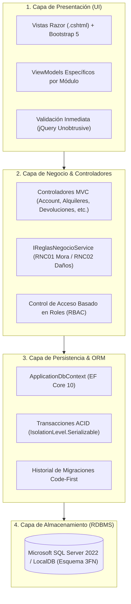

# 👗 LucyVest Control — Sistema de Alquiler de Vestimentas

<div align="center">

[](https://dotnet.microsoft.com/)
[](https://learn.microsoft.com/dotnet/csharp/)
[](https://learn.microsoft.com/aspnet/core/)
[](https://learn.microsoft.com/ef/core/)
[](https://www.microsoft.com/sql-server/)
[](https://getbootstrap.com/)
[](https://www.gob.pe/institucion/minjus/campa%C3%B1as/323-ley-de-proteccion-de-datos-personales)

<p align="center">
  <strong>Plataforma web empresarial para el control de inventario, emisión de contratos digitales, liquidación automática de moras y gestión de mantenimiento de vestimentas tradicionales y trajes de gala.</strong>
</p>

<p align="center">
  <em>Desarrollado para el taller artesanal <strong>“Alquiler de Vestimentas Lucy”</strong> (Cajamarca, Perú).</em><br>
  <em>Diseño y Arquitectura de Software (DIARS) · Ciclo 2026-2 · Universidad Privada del Norte</em>
</p>

[✨ Características](#-características-principales) •
[🏛️ Arquitectura](#-arquitectura-del-sistema) •
[⚙️ Reglas de Negocio](#-automatización-de-reglas-de-negocio-rnc) •
[🚀 Instalación](#-puesta-en-marcha) •
[🔐 Seguridad](#-seguridad-y-cumplimiento) •
[📁 Estructura](#-estructura-del-proyecto)

</div>

---

## 📌 Visión General

**LucyVest Control** resuelve la problemática operativa de los talleres de alquiler de trajes típicos: pérdida de stock, sobrecostos por prendas devueltas con deterioro no identificado, demoras en la atención al cliente y falta de control sobre las garantías en custodia. 

La solución implementa una **Arquitectura en Capas (N-Tier)** estricta y transacciones relacionales **ACID** (aislamiento *Serializable*) para garantizar cero discrepancias en el inventario, junto a un diseño visual ergonómico inspirado en la artesanía cajamarquina (paleta ciruela, marfil y madera con tipografías *Lora* e *Inter*).

---

## ✨ Características Principales

<table>
  <tr>
    <td width="50%">
      <h3>👗 Catálogo & Trazabilidad Individual</h3>
      <ul>
        <li><b>Identificación Unívoca:</b> Código alfanumérico único por prenda física (ej. <code>MN001</code>, <code>POL001</code>).</li>
        <li><b>Máquina de Estados:</b> <code>Disponible</code> ➔ <code>Alquilada</code> ➔ <code>EnMantenimiento</code> ➔ <code>DeBaja</code>.</li>
        <li><b>Baja Lógica:</b> Mantiene intacta la trazabilidad histórica y contractual de las prendas.</li>
      </ul>
    </td>
    <td width="50%">
      <h3>⚡ Emisión de Contratos en 2 Clics</h3>
      <ul>
        <li><b>Atención Ultra Rápida:</b> Generación del contrato en menos de 2 minutos.</li>
        <li><b>Validación Concurrente:</b> Revalidación transaccional de disponibilidad antes del commit.</li>
        <li><b>Contrato Digital Imprimible:</b> Vista optimizada para generar PDF listo para firma del cliente.</li>
      </ul>
    </td>
  </tr>
  <tr>
    <td width="50%">
      <h3>🔍 Inspección Física por Prenda</h3>
      <ul>
        <li><b>Auditoría Individual:</b> Calificación por ítem en retorno (<code>Óptimo</code>, <code>Daño Leve</code>, <code>Daño Grave</code>).</li>
        <li><b>Derivación Automática:</b> Envío inmediato al taller de mantenimiento con generación de orden de trabajo.</li>
        <li><b>Constancia de Retorno:</b> Comprobante detallado de reembolso y liquidación final.</li>
      </ul>
    </td>
    <td width="50%">
      <h3>📊 Supervisión Financiera & Taller</h3>
      <ul>
        <li><b>Control de Mantenimiento:</b> Seguimiento a órdenes de lavandería, costura y desinfección.</li>
        <li><b>Reportes Ejecutivos:</b> Balance de ingresos, mora recaudada y garantías en custodia activa.</li>
        <li><b>Exportación Universal:</b> Descargas en formato CSV (UTF-8 con BOM) compatibles con Excel.</li>
      </ul>
    </td>
  </tr>
</table>

---

## 🏛️ Arquitectura del Sistema

El sistema implementa una **Arquitectura en Capas (N-Tier)** desacoplada sobre **ASP.NET Core 10 MVC**, garantizando alta cohesión y bajo acoplamiento:



### Principios Clave
* **Separación de Intereses (SoC):** La vista jamás calcula montos ni manipula entidades de base de datos directamente; se comunica exclusivamente mediante `ViewModels`.
* **Transacciones ACID Estrictas:** Operaciones críticas como la confirmación del alquiler y la recepción de devoluciones se ejecutan bajo nivel de aislamiento `Serializable`.
* **Inyección de Dependencias:** Todos los servicios de negocio (`IReglasNegocioService`) y administradores de identidad se inyectan en el contenedor nativo de ASP.NET Core.

---

## ⚙️ Automatización de Reglas de Negocio (RNC)

Toda fórmula financiera se ejecuta en la capa de negocio ([ReglasNegocioService.cs](file:///home/zodd/Downloads/T2_Arqui/Sistema/AlquilerVestimentasLucy/Services/ReglasNegocioService.cs)) alimentada por las tarifas configuradas por la Administradora:

### 🕒 RNC01 — Mora por Retraso
Cada fracción o bloque de 24 horas transcurridas desde la fecha y hora pactada de devolución cuenta como un día completo de mora:

$$\text{Días de Mora} = \left\lceil \frac{\text{Horas de Retraso}}{24} \right\rceil$$

$$\text{Monto Mora} = \text{Días de Mora} \times \text{Tarifa Diaria}$$

### ✂️ RNC02 — Penalidad por Deterioro Físico
Calculada individualmente por cada prenda devuelta según su inspección:
* **Óptimo:** $S/\ 0.00$
* **Daño Leve:** $\text{Costo Base de Reparación} \times \text{Porcentaje Daño Leve}$ (ej. 50%)
* **Daño Grave:** $\text{Costo Base de Reparación} \times \text{Porcentaje Daño Grave}$ (ej. 100%)

### 💰 Liquidación Final de Garantía
$$\text{Reembolso al Cliente} = \max(0, \text{Total Garantía} - \text{Total Penalidad})$$
$$\text{Saldo Pendiente de Cobro} = \max(0, \text{Total Penalidad} - \text{Total Garantía})$$

---

## 🛠️ Stack Tecnológico

| Componente | Tecnología | Propósito |
| :--- | :--- | :--- |
| **Backend** | C# 14 / .NET 10 (`net10.0`) | Lenguaje fuertemente tipado de alto rendimiento |
| **Web Framework** | ASP.NET Core 10 MVC | Enrutamiento, controladores y pipeline HTTP |
| **ORM** | Entity Framework Core 10.0.14 | Mapeo objeto-relacional Code-First y LINQ |
| **Base de Datos** | SQL Server 2022 / LocalDB | Motor de base de datos relacional normalizado a 3FN |
| **Seguridad** | ASP.NET Core Identity | Cifrado PBKDF2 de credenciales y autorización RBAC |
| **Frontend** | Razor, Bootstrap 5.3, CSS Tokens | UI responsiva, ergonómica y accesible |
| **Tipografía Local** | Lora (serif) & Inter (sans-serif) | Identidad visual artesanal servida localmente sin CDN |

---

## 🔐 Seguridad y Cumplimiento

* **Control de Acceso Basado en Roles (RBAC):**
  * `Administradora`: Control total del sistema, configuración de políticas y tarifas, gestión y reseteo de usuarios.
  * `Vendedor`: Alta de clientes, emisión de contratos y registro de devoluciones.
  * `Asistente`: Inspección de prendas y control de órdenes en lavandería/costura.
* **Ley N° 29733 (Protección de Datos Personales - Perú):**
  * Registro de DNI estricto de 8 dígitos numéricos.
  * Checkbox mandatorio de consentimiento informado para tratamiento de datos personales en el registro de clientes.
* **Seguridad Web:**
  * Mitigación de CSRF mediante atributos `[ValidateAntiForgeryToken]` en todas las acciones mutables.
  * Prevención total de inyecciones SQL a través de consultas parametrizadas nativas en EF Core.
  * Invalidación automática de sesiones ante cambios de rol o desactivación de cuentas.

---

## 🚀 Puesta en Marcha

### Prerrequisitos
* [.NET 10 SDK](https://dotnet.microsoft.com/download)
* SQL Server 2022 (LocalDB en Windows, o Docker / Podman en Linux/macOS)

### 1. Clonar el repositorio
```bash
git clone https://github.com/JhonPao/SistemaAlquilerLucy.git
cd SistemaAlquilerLucy
```

### 2. Levantar el Motor de Base de Datos (ejemplo Docker/Podman)
```bash
podman run -d --name sqlserver \
  -e ACCEPT_EULA=Y \
  -e MSSQL_SA_PASSWORD='TuPasswordFuerte2026*' \
  -p 1433:1433 \
  mcr.microsoft.com/mssql/server:2022-latest
```

### 3. Configurar Cadena de Conexión (User Secrets)
Para preservar la seguridad y evitar exponer contraseñas en Git:
```bash
dotnet user-secrets set "ConnectionStrings:DefaultConnection" \
  "Server=localhost,1433;Database=AlquilerVestimentasLucyDB;User Id=sa;Password=TuPasswordFuerte2026*;TrustServerCertificate=True"
```

### 4. Aplicar Migraciones y Ejecutar
```bash
dotnet tool restore
dotnet ef database update
dotnet run
```

La aplicación aplicará automáticamente las migraciones y sembrará los roles, políticas iniciales y datos de prueba.

* **URL de Acceso:** `http://localhost:5226` o `https://localhost:7226`

---

## 🔑 Credenciales de Demostración (Entorno de Desarrollo)

Al ejecutarse en modo `Development`, la base de datos se inicializa automáticamente con la siguiente cuenta de acceso:

| Rol | Correo Electrónico | Contraseña |
| :--- | :--- | :--- |
| **Administradora** | `admin@lucy.local` | `Lucy2026*` |

> [!NOTE]  
> En entornos de producción, el sembrado de demostración se deshabilita automáticamente y las credenciales deben suministrarse mediante variables de entorno seguras.

---

## 📁 Estructura del Proyecto

```text
AlquilerVestimentasLucy/
├── Controllers/                 # Controladores MVC organizados por contexto
│   ├── AccountController.cs         # Autenticación y control de sesiones
│   ├── HomeController.cs            # Panel general y KPIs en tiempo real
│   ├── PrendasController.cs         # Inventario, catálogo y trazabilidad
│   ├── ClientesController.cs        # Gestión de arrendatarios y Ley 29733
│   ├── AlquileresController.cs      # Emisión de contratos y salidas
│   ├── DevolucionesController.cs    # Recepción, inspección y liquidación
│   ├── MantenimientosController.cs  # Órdenes de lavandería y costura
│   ├── ReportesController.cs        # Balances e indicadores financieros
│   └── AdministracionController.cs  # Usuarios, roles y configuración de tarifas
├── Models/                      # Entidades del dominio normalizadas a 3FN
├── ViewModels/                  # Modelos de vista desacoplados
├── Services/                    # Reglas de negocio puras (IReglasNegocioService)
├── Data/                        # ApplicationDbContext y DbInitializer (Seed)
├── Migrations/                  # Historial de migraciones EF Core Code-First
├── Views/                       # Vistas Razor (.cshtml) responsivas
└── wwwroot/                     # Activos estáticos (CSS con tokens, iconos, tipografías)
```

---

## 👥 Equipo de Desarrollo

* **Jhon Paolo** — *Diseño de Arquitectura, Modelado de Datos y Desarrollo Backend*
* **Curso:** Diseño y Arquitectura de Software (DIARS) · 2026-2
* **Institución:** Universidad Privada del Norte (UPN - Sede Cajamarca)

---

<div align="center">
  <sub>Construido con dedicación para el patrimonio cultural y textil de Cajamarca.</sub>
</div>
